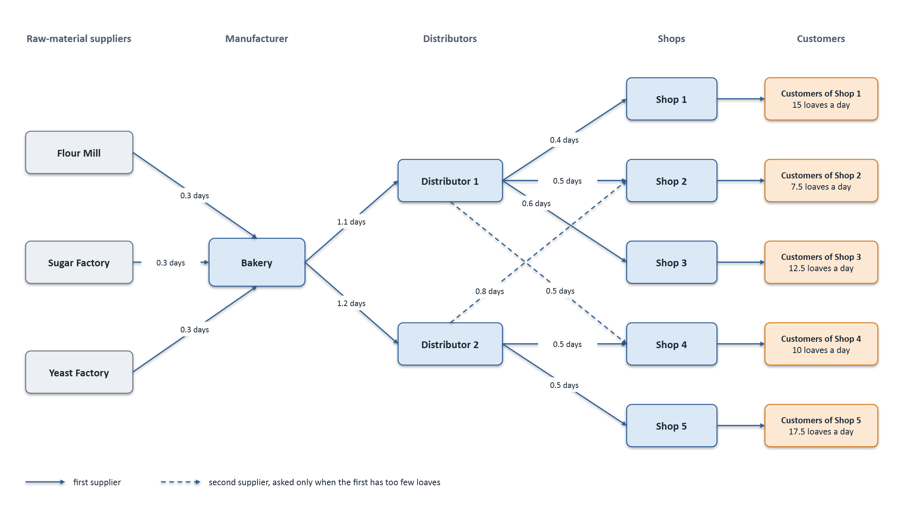

# Optimizing inventory in a perishable bread supply chain

A bakery makes bread from flour, sugar and yeast. Two distributors take the loaves to five shops, where customers buy them. A loaf can be sold for only 5 days after it was made. A shop that keeps too few loaves turns customers away, and a site that keeps too many throws loaves away when they expire. Now and then the bakery stops for 2 days, after an equipment fault or a strike.

This repository is our optimization study of that supply chain. We ask how much inventory each site should keep to make the highest mean network profit, and whether the answer changes when the bakery is disrupted. We simulate the supply chain with [SupplyNetPy](https://github.com/SupplyChainSimulation/SupplyNetPy) 0.5.1, and a genetic algorithm searches the values of the replenishment policies with the simulation as a black box.

We have finished the model, its checks, the pilot runs, the search and the checks after it. We will add an archived release.

## The bread supply chain



Each arrow is a link that carries replenishment orders. Its label gives the link's ID and its lead time, the days an order takes to arrive. Shops 2 and 4 turn to a second distributor (dashed arrow) when their first has too few loaves. Each shop has its own customers, 62.5 loaves a day in all. The [model](model/README.md) page gives the rest of the parameter values.

## The study in brief

Each of the 8 sites that hold bread (the bakery, the 2 distributors and the 5 shops) uses an (s, S) policy. When its inventory position (the loaves at the site, plus those on their way, minus those it owes) falls to the reorder point s, it orders enough to bring the position back up to the order-up-to level S. At the bakery, the same rule decides how many loaves to make. These 16 numbers are what we search.

The answer is not obvious, because bread is perishable. Every day a loaf waits at the bakery or a distributor comes out of its 5-day shelf life, so inventory kept upstream reaches the shops old. Disruptions of the bakery pull the other way, since inventory is the only protection the shops have.

We work in three steps, each in its own folder.

| Step | What it does | Folder |
|---|---|---|
| Model | Builds the supply chain, with its prices, costs, customers and disruptions of the bakery, and verifies it with 84 checks | [model/](model/README.md) |
| Pilot | Sets the warm-up (30 days), the run length (365 days) and the number of search seeds (10), and times the runs | [pilot/](pilot/README.md) |
| Optimization | Searches the values of s and S with a genetic algorithm in 4 cases (no disruptions, and one disruption of the bakery per 200, 100 or 50 days on average), then checks the best values found on 100 new seeds, across the cases, and against hand-set values | [optimization/](optimization/README.md) |

The parameter values are illustrative. We chose them for this study and did not measure them at a real bakery. We call the results best found, because a search of this kind cannot prove that no better values of s and S exist. We use the words of the glossary of the SupplyNetPy documentation, in which a site is any node other than a customer demand, and an expired unit is a loaf thrown away at the end of its shelf life.

## What we found

Money is in rupees, and a ± value is the half-width of a 95% confidence interval. The [optimization](optimization/README.md) page gives the full results.

- With no disruptions, the best values found make 511.6 ± 3.8 a day on 100 new seeds, against 305.3 ± 20.2 on the 10 search seeds for hand-set values. They serve 87.8% of the loaves customers ask for, and 4.9% of that amount expires.
- With one disruption of the bakery per 200, 100 and 50 days, the best values found make 491.7, 484.5 and 464.6 a day.
- The best values found with no disruptions do better in every disrupted case than the best values found for that case, by 7 to 12 a day. So the searches with disruptions did not find those values, or values as good. The runs of the genetic algorithm in a case end far apart, so what one run finds depends on its seed.
- The best values found keep 1.5 to 1.7 days of demand in the whole network, most of it at the shops, since a loaf held upstream reaches a shop with less of its shelf life left. In 18 of the 20 runs of the genetic algorithm, the bakery's reorder point is 0.

## Requirements

Python 3.9 or later, tested with Python 3.11.5. The exact versions we used, including `supplynetpy==0.5.1` and `pygad==3.9.2`, are pinned in `requirements.txt`.

```
python -m pip install -r requirements.txt
```

## Running

Run every script from the repository folder, as a module. For example, the model's checks take about 10 seconds.

```
python -m model.check_model
```

Each folder's page lists its commands and how long they take. [FILES.md](FILES.md) lists every file in the repository, with what each script reads and writes and the columns of every results file.

## License

MIT. See [LICENSE](LICENSE).
