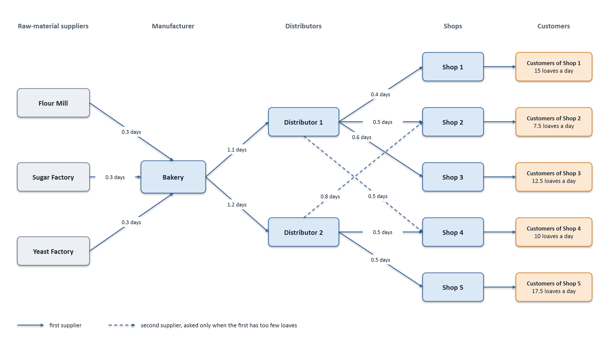

# The bread supply chain model

A customer walks into Shop 3 and asks for 3 loaves. If the shop has them, it sells them at 40 rupees each. If it has only 2, the customer takes the 2 and leaves, and the third loaf is a lost sale. Behind the shop stands a distributor, which brought the loaves from a bakery the day before, and the bakery made them from flour, sugar and yeast. Every loaf can be sold for only 5 days after it was made. A shop that keeps too few loaves turns customers away, and a site that keeps too many throws loaves away when they expire.

This folder holds a simulation model of that supply chain, built with [SupplyNetPy](https://github.com/SupplyChainSimulation/SupplyNetPy) 0.5.1, and the checks that verify it. The model is a new case study, inspired by the bread example that comes with SupplyNetPy. Its parameter values are illustrative. We chose them for this study and did not measure them at a real bakery.

Here and in the code we use the words of the glossary in the [SupplyNetPy documentation](https://supplychainsimulation.github.io/SupplyNetPy/). One time unit is one day, one unit of bread is one 400 g loaf, and money is in rupees.

## The network

A site is any node of the network other than a customer demand. The model has 11 sites. The 3 raw-material suppliers never run out and hold no inventory, and the other 8 sites hold bread in 3 echelons. An echelon is a level of the network whose sites hold inventory, here the bakery, the distributors or the shops.

| Node type | Sites |
|---|---|
| Raw-material suppliers | Flour mill, sugar factory, yeast factory |
| Manufacturer | Bakery |
| Distributors | Distributor 1, Distributor 2 |
| Shops | Shops 1 to 5, each with its own customers |

The sites are joined by 12 links. A link carries replenishment orders from one site to another. Each link has a cost per replenishment order and a lead time, which is how long an order takes to arrive after it is sent. The diagram shows each link with its lead time, and each shop with the mean number of loaves its customers ask for in a day.



[network_diagrams.pdf](../optimization/results/network_diagrams.pdf) draws the same network with every parameter value on it. It has one page for each case, with the best values of s and S found for that case.
Solid arrows are the first supplier of each site. Shops 2 and 4 have a second supplier, drawn with a dashed arrow. Each of them asks its first supplier and turns to the second only when the first has too few loaves for the whole order. The choice is made again for every replenishment order (`SelectAvailable` in dynamic mode). The model creates the links in the order of their IDs, and that order decides which supplier is first, so l7 comes before l12 and l9 before l11.

The network structure is fixed. We change only the reorder points and order-up-to levels of the sites and how often the bakery is disrupted.

## Bread and its shelf life

Bread is perishable. Its shelf life is 5 days at every site, counted from the day the loaf was made (its manufacturing date). Loaves made together form a batch, and every order takes loaves from the oldest batch first. A loaf that reaches the end of its shelf life is thrown away and counted as an expired unit. The site has already paid for it, so an expired loaf costs its full price and earns nothing.

The time a loaf spends at the bakery, at a distributor and on the links all comes out of the same 5 days. A loaf that waits 2 days upstream reaches a shop with 3 days left. The longest lead time, 1.2 days on l5, is well below the shelf life, so loaves seldom expire on the way.

## Customers

Customer orders arrive at each shop one at a time, at random (a Poisson process). Each order is for 1, 2, 3 or 4 loaves, each equally likely, so an order is 2.5 loaves on average. Shops 1 to 5 get 6, 3, 5, 4 and 7 orders a day on average, which makes 15, 7.5, 12.5, 10 and 17.5 loaves a day, 62.5 loaves a day in all.

A customer who finds too few loaves takes the loaves that are there and leaves. The rest of the order is a lost sale. Customers do not wait.

The model reports the customer fill rate, the share of the loaves customers ask for that the shops deliver. A customer fill rate of 0.85 means that 85 of every 100 loaves asked for were sold.

## Replenishment and production

Each of the 8 sites that hold bread (the bakery, the 2 distributors and the 5 shops) decides when to order and how much with an (s, S) policy. The policy looks at the site's inventory position, which is the loaves at the site, plus the loaves on their way to it, minus the loaves it still owes to other sites. When the inventory position falls to s or below, the site places a replenishment order that brings it back up to S. Here s is the reorder point and S the order-up-to level.

For example, Shop 1 with s = 25 and S = 40 sells loaves until its inventory position falls to 25 or below, say to 23. It then orders 17 loaves from Distributor 1, which arrive 0.4 days later.

At the bakery, the same policy decides production. When the bakery's inventory position falls to s, it plans enough loaves to bring the position back to S. At that moment it orders exactly the raw materials for those loaves, one order on each of l1, l2 and l3. It makes the loaves in production batches of up to 300 loaves, each taking 1 day. The raw-material suppliers never run out (they are infinite suppliers in SupplyNetPy).

The 16 numbers, s and S at each of the 8 sites, are what the [optimization](../optimization/README.md) searches.

## Money

Every site buys at its supplier's sell price and sells at a markup. The bakery sells at 28 rupees a loaf, both distributors at 32 and the shops at 40. Shops 2 and 4 buy from both distributors at a single buy price, so the two distributors must sell at the same price.

Network profit is the sum of the profits of the bakery, the distributors and the shops. Sales between these sites cancel out of it, because what one site earns another pays. What remains is the money from customers, minus the raw materials, the manufacturing cost, the holding cost and the transportation cost. Raw materials cost 12.05 rupees per loaf and manufacturing costs 10, so a loaf costs 22.05 to make and the network earns 17.95 on each loaf sold. Holding a loaf costs 0.2 rupees a day at the bakery, 0.3 at a distributor and 0.5 at a shop. Every replenishment order pays the cost of its link.

If every customer were served and no loaf expired, the network would make 1,122 rupees a day before holding and transportation costs (62.5 loaves a day at 17.95 a loaf).

## Fixed lead times

Each link's lead time is fixed. Customer demand is the only random input when there are no disruptions.

SupplyNetPy handles events that fall at the same simulated time in the order of its event queue, which the model does not control. If a delivery arrived at the same moment as a production batch ended, a result could depend on that order. We therefore chose the lead times so that this never happens. For this reason we set l4 to 1.1 days, not the 1.0 days of the library's example, since a production batch takes exactly 1 day.

## Disruptions of the bakery

A disruption is a period when a site is out of action. In this model only the bakery is disrupted, for example by an equipment fault or a strike. The bakery is the only manufacturer and both distributors depend on it, so its disruptions reach every shop. With no backup bakery, the sites can protect themselves only through the inventory their values of s and S keep.

A disruption lasts 2 days. While it lasts, the bakery takes no replenishment orders from the distributors and starts no production batch. A production batch already under way finishes. A distributor that cannot place its order (a blocked order in SupplyNetPy) orders again when the bakery recovers. No loaves are destroyed.

Disruptions start at random. The time from the end of one disruption to the start of the next is exponential, so disruptions do not come at regular intervals. We study 4 cases, with no disruptions, or one disruption per 200, 100 or 50 days on average, counted from the start of one disruption to the start of the next.

SupplyNetPy stops a disrupted site from taking orders but lets a disrupted manufacturer go on producing. We add the halt in production to the model ourselves, by having the bakery wait for the end of a disruption before it starts a production batch.

## Random numbers and common random numbers

The customers of each shop and the disruptions of the bakery each draw from their own random number generator, started from the seed of the run. Nothing in them depends on the values of s and S. Two sets of values run with the same seed therefore face the same customers and the same disruptions. This is called common random numbers, and it means that a difference in profit between two sets of values comes from the values themselves and not from luck.

## Warm-up and run length

Every run starts with about 2 days of demand at each site, which the run gets for free, and with nothing on its way and no order waiting. The first days of a run therefore do not look like the rest. Each run discards a warm-up of 30 days, resets its statistics, and then measures 365 days. The [pilot](../pilot/README.md) set both lengths.

## Parameter values

All values sit in one block at the top of `bread_model.py`, each with its unit and its source. "Example" means the value comes from the bread example of SupplyNetPy, and "study" means we set it for this study.

| Parameter | Value | Source |
|---|---|---|
| Flour per loaf, price | 250 g at 0.040 rupees a gram | study |
| Sugar per loaf, price | 10 g at 0.045 rupees a gram | study |
| Yeast per loaf, price | 4 g at 0.40 rupees a gram | study |
| Manufacturing cost | 10 rupees a loaf | example |
| Production batch | up to 300 loaves, 1 day | example |
| Shelf life | 5 days at every site | example |
| Sell price, bakery | 28 rupees a loaf | study |
| Sell price, distributors | 32 rupees a loaf | study |
| Sell price, shops | 40 rupees a loaf | example |
| Holding cost | 0.2 (bakery), 0.3 (distributors), 0.5 (shops) rupees a loaf a day | study |
| Capacity | no limit at the bakery and the distributors, 150 loaves at each shop | study |
| Initial inventory level | 125 (bakery), 70 and 55 (distributors), 30, 15, 25, 20 and 35 (shops) loaves | study |
| Customer orders a day | 6, 3, 5, 4 and 7 at Shops 1 to 5 | study |
| Loaves per customer order | 1 to 4, each equally likely | example |
| Disruption length | 2 days | study |
| Mean days between disruptions | 200, 100 or 50, or no disruptions | study |
| Warm-up, measured days | 30, 365 | study, from the pilot |

| Link | From | To | Cost per replenishment order (rupees) | Lead time (days) |
|---|---|---|---|---|
| l1 | Flour mill | Bakery | 50 | 0.3 |
| l2 | Sugar factory | Bakery | 60 | 0.3 |
| l3 | Yeast factory | Bakery | 50 | 0.3 |
| l4 | Bakery | Distributor 1 | 60 | 1.1 |
| l5 | Bakery | Distributor 2 | 70 | 1.2 |
| l6 | Distributor 1 | Shop 1 | 40 | 0.4 |
| l7 | Distributor 1 | Shop 2 | 40 | 0.5 |
| l8 | Distributor 1 | Shop 3 | 40 | 0.6 |
| l9 | Distributor 2 | Shop 4 | 50 | 0.5 |
| l10 | Distributor 2 | Shop 5 | 50 | 0.5 |
| l11 | Distributor 1 | Shop 4 | 80 | 0.5 |
| l12 | Distributor 2 | Shop 2 | 60 | 0.8 |

The link costs are the example's costs times 10. The lead times are the example's mean lead times, except l4 (see above).

The bakery and the distributors have no capacity limit, because a buyer could otherwise place an order larger than its supplier can ever hold, and that order would never be filled. Each shop's capacity of 150 loaves is also the largest S the search tries there, so no delivery is cut short.

## Verification

`check_model.py` verifies that the model does what this page describes. It makes 84 checks, which ask the following.

1. The same seed gives the same run.
2. Two different sets of values run with the same seed face the same customers.
3. Units balance. At every site, the loaves that came in minus the loaves that went out equal the change in its inventory level. The raw materials the bakery received match the loaves it made. At every shop, the loaves delivered to customers plus the lost sales equal the loaves they asked for.
4. The parts of the profit add up, at every site and for the whole network.
5. No warning appears, in particular none about an order that can never be filled.
6. A run with no disruptions gives exactly the profit recorded before disruptions were added to the model.
7. Two different sets of values run with the same seed face the same disruptions.
8. Each disruption lasts 2 days.
9. The bakery starts no production batch while it is disrupted, and the distributors' orders are blocked.

Checks 3 and 4 are made twice, with no disruptions and with one disruption per 50 days. All 84 checks pass. The checks use hand-set trial values, which set each site's s and S as days of its own mean demand. The [pilot](../pilot/README.md) and the baseline check of the [optimization](../optimization/README.md) use the same trial values.

## Running the model

Run the checks from the repository folder (about 10 seconds).

```
python -m model.check_model
```

It prints one line per check and the number passed, and ends with exit code 1 if any check fails.

Our other scripts use the model as a module. `run_network` builds the network, runs the warm-up and the measured days, and returns the network with its results.

```python
from model import bread_model as bm

settings = {
    "bakery": {"s": 0, "S": 55},
    "distributor1": {"s": 44, "S": 82}, "distributor2": {"s": 58, "S": 91},
    "shop1": {"s": 25, "S": 40}, "shop2": {"s": 5, "S": 18}, "shop3": {"s": 13, "S": 27},
    "shop4": {"s": 6, "S": 18}, "shop5": {"s": 19, "S": 34},
}
sc = bm.run_network(settings, seed=2001, days_between_disruptions=50)  # None for no disruptions
print(sc["profit"] / bm.RUN_LENGTH)  # network profit a day over the 365 measured days
```

`build_network` returns the same network before it is run, and `customer_fill_rate` gives one shop's customer fill rate. [FILES.md](../FILES.md) describes both files of this folder.
