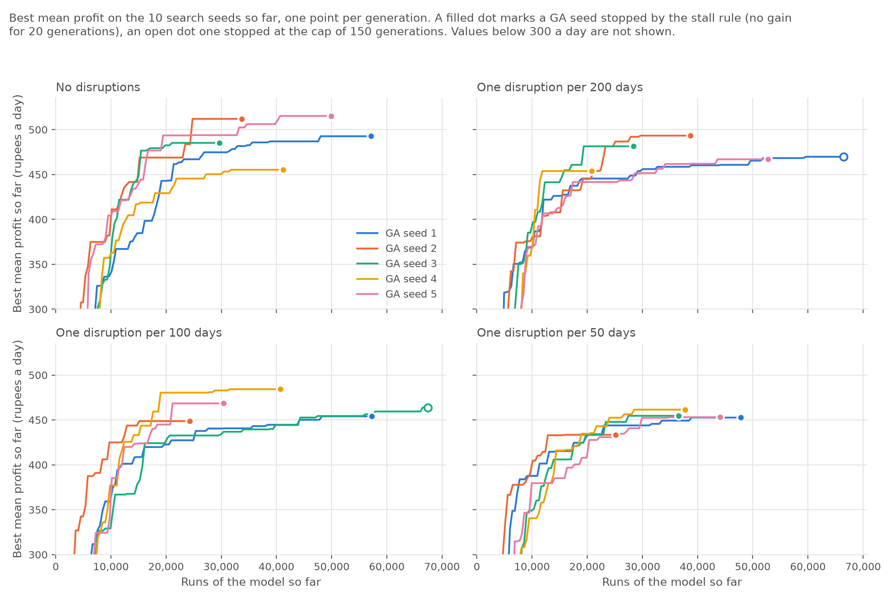
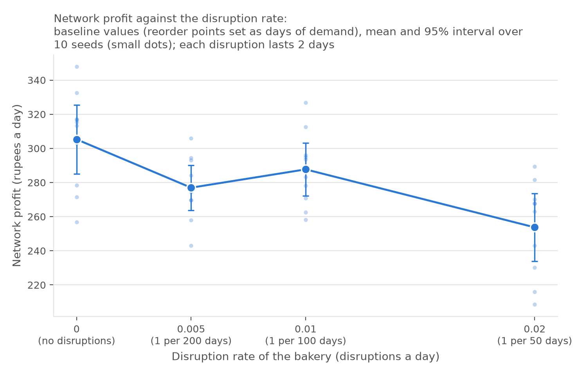
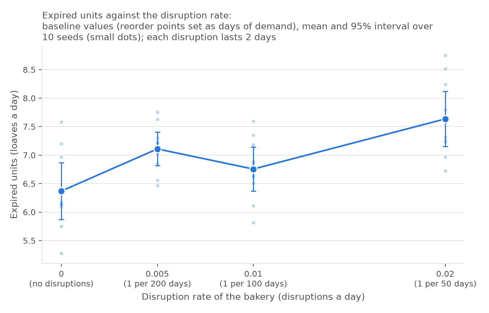
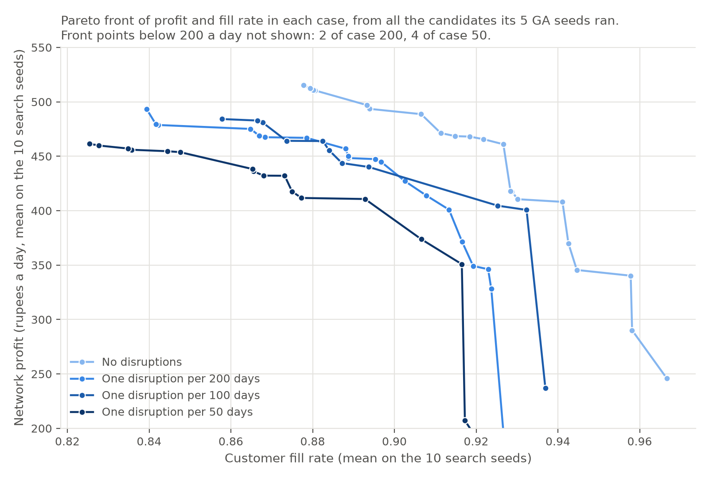

# The search for the best values of s and S

Shop 1 sells about 15 loaves a day. Should it order when it is down to 10 loaves, or to 25? Should it fill up to 30, or to 60? Each choice changes how many customers it turns away and how many loaves expire. The same choice is made at the other 4 shops, at the 2 distributors and at the bakery, and each one changes what the others see. There are far too many combinations to try them all.

This folder holds our optimization study. We search the values of s and S at the 8 sites that hold bread for the highest mean network profit with a genetic algorithm, using the [bread model](../model/README.md) as a black box. We search 4 cases, with no disruptions of the bakery and with one disruption per 200, 100 or 50 days on average. We then check the best values found on new seeds, across the cases, and against hand-set values.

## The search problem

Each of the 8 sites that hold bread uses an (s, S) policy. When its inventory position (the loaves at the site, plus those on their way, minus those it owes) falls to the reorder point s or below, it orders enough to bring the inventory position back up to the order-up-to level S. A candidate is one choice of these 16 integers.

S runs from 10 to 150 loaves at the shops (their capacity is 150), from 10 to 300 at the distributors and from 10 to 600 at the bakery. Each s runs from 0 to its site's largest S minus 1. An (s, S) policy needs s below S, so a candidate with s at or above S at some site is not valid. It is not run, and it gets a score far below any profit, so the search moves away from it.

A candidate's score is its mean network profit a day over 10 search seeds (1001 to 1010). Each run leaves out a 30-day warm-up and measures 365 days, as set by the [pilot](../pilot/README.md). Every candidate runs on the same seeds, so all of them face the same customers and the same disruptions (common random numbers). A candidate the search has seen before reuses its score, so it is run only once.

The customer fill rate, the share of the loaves customers ask for that the shops deliver, is recorded for every candidate but is not part of the score.

## The genetic algorithm

A genetic algorithm (GA) keeps a population of candidates and improves it one generation at a time, as breeding improves a herd. Here a generation has 50 candidates, and the 16 integers of a candidate are its genes.

1. The first generation is 50 valid candidates drawn at random.
2. Each candidate is scored on the 10 search seeds.
3. The best candidate passes to the next generation unchanged.
4. The 25 best candidates are the parents. Each of the other 49 places goes to a child of two parents. The child takes the genes of one parent up to a random point and the rest from the other (single-point crossover).
5. One gene of each child then moves up or down by a random step of up to 10% of its range (mutation). For example, a shop's S moves by up to 14 loaves.
6. The new generation goes back to step 2.

The GA stops when the best candidate has not improved for 20 generations (the stall rule), or after 150 generations, whichever comes first. We use PyGAD's GA, with our own mutation step.

We run the GA 5 times in each case, each run started from its own GA seed (1 to 5). Five independent runs show whether the search ends in the same place wherever it starts.

## The checks after the search

The search picks each run's best candidate out of thousands, on the same 10 seeds. Some of that candidate's lead is luck on those seeds, so its mean there is biased upward. We therefore follow the search with three checks, on seeds the search never used.

The **final check** runs the best values found by the 5 GA seeds of a case on 100 new seeds (2001 to 2100), in that case. For each set of values it reports (a) its mean profit on the search seeds, (b) its mean profit on the new seeds, so that (a) − (b) shows the upward bias, and (c) its paired difference from the best of the five. A paired difference compares two sets of values seed by seed, which removes the effect of the customers they share, so it is much more precise than comparing two means. A paired interval that contains 0 means the two sets of values tie.

The **cross-case check** asks how the best values found for a case do when the disruption rate differs from the one they were searched for. It takes the best values found for each case (the best of the five in its final check) and runs them in every case, on the same 100 new seeds. In each case it compares the four sets of values with those found for that case.

The **baseline check** shows what disruptions do to values that no search tuned. It runs the trial values of the model's checks in every case, on the 10 search seeds. They set each site's s and S as days of its own mean demand (0.5 and 2.0 days at the bakery, 1.0 and 2.0 at the distributors, 0.5 and 1.5 at the shops).

Finally, the **Pareto front** of each case shows what a higher customer fill rate costs in profit. It is the set of candidates that no other candidate beats on both mean profit and customer fill rate, taken from all the candidates the case's searches ran, with no new runs.

## Results

Money is in rupees a day. A ± value is the half-width of a 95% confidence interval, the distance from the mean to either end of it. The interval is over the 10 search seeds for the search and the baseline check, and over the 100 new seeds for the final check and the cross-case check. Every number comes from the CSV files in `results/`, described in [FILES.md](../FILES.md), and the commands that made them are under [Running the optimization](#running-the-optimization).

### The search

Each GA seed started from random values that lost money (−289 to −876 a day for the best starting candidate) and passed 300 a day between generations 8 and 19. The table gives the best found of each GA seed, as its mean profit on the search seeds, with the generation it was found in and the number of generations run. Generations are counted from 0, so 128 generations run means generations 0 to 127.

| Case | GA seed 1 | GA seed 2 | GA seed 3 | GA seed 4 | GA seed 5 |
|---|---|---|---|---|---|
| No disruptions | 492.6 (107 of 128) | 512.0 (55 of 76) | 485.2 (48 of 69) | 455.3 (73 of 94) | **515.2** (89 of 110) |
| One per 200 days | 469.8 (134 of 150) | **493.3** (66 of 87) | 481.4 (44 of 65) | 453.8 (27 of 48) | 466.9 (97 of 118) |
| One per 100 days | 454.0 (108 of 129) | 448.6 (34 of 55) | 463.8 (147 of 150) | **484.2** (71 of 92) | 468.4 (47 of 68) |
| One per 50 days | 452.6 (86 of 107) | 433.5 (35 of 56) | 454.6 (61 of 82) | **461.5** (64 of 85) | 453.1 (77 of 98) |

The half-widths on the search seeds are 10 to 15 a day in the first three cases and 17 to 22 a day with one disruption per 50 days.



The figure shows how each run climbed, against the number of runs of the model so far. The y-axis starts at 300 a day, so the first generations, which lose money, are not shown. 18 of the 20 runs stopped by the stall rule. 2 stopped at the cap of 150 generations. Of these, GA seed 1 with one disruption per 200 days last improved in generation 134, and GA seed 3 with one per 100 days was still rising (454.4 in generation 120, 463.8 in generation 147).

In each case the 5 GA seeds end 28 to 60 a day apart, more than the noise of the search seeds. So where a run ends depends on where it started. The three runs that found their best earliest (in generations 27, 34 and 35) are the worst of their cases.

Single-point crossover can join the s of one parent to a smaller S of the other at the same site, which gives a child that is not valid. Between 6.6% and 10.2% of the children of each run were not valid. With the scores of candidates seen before reused, each run ran between 2,082 and 6,742 distinct valid candidates, which is 20,820 to 67,420 runs of the model.

### Final check

The table gives the mean profit of the best values found by each GA seed on the 100 new seeds (upper value) and its paired difference from the best of the five in the same case (lower value).

| Case | GA seed 1 | GA seed 2 | GA seed 3 | GA seed 4 | GA seed 5 |
|---|---|---|---|---|---|
| No disruptions | 490.8 ± 3.5<br>−20.9 ± 3.4 | 504.3 ± 4.0<br>−7.3 ± 3.3 | 475.9 ± 3.5<br>−35.8 ± 3.0 | 451.7 ± 3.6<br>−59.9 ± 3.3 | **511.6 ± 3.8**<br>best |
| One per 200 days | 465.3 ± 3.3<br>−26.4 ± 2.9 | **491.7 ± 3.7**<br>best | 478.2 ± 3.4<br>−13.5 ± 3.2 | 458.6 ± 3.9<br>−33.1 ± 3.1 | 468.0 ± 4.4<br>−23.7 ± 2.9 |
| One per 100 days | 453.2 ± 3.7<br>−31.4 ± 3.7 | 445.3 ± 3.5<br>−39.2 ± 3.6 | 464.2 ± 4.6<br>−20.4 ± 3.8 | **484.5 ± 4.5**<br>best | 470.3 ± 3.8<br>−14.2 ± 4.1 |
| One per 50 days | 451.6 ± 4.5<br>−13.0 ± 3.5 | 432.9 ± 3.8<br>−31.7 ± 3.3 | 450.6 ± 4.2<br>−14.0 ± 3.9 | **464.6 ± 3.7**<br>best | 452.1 ± 4.1<br>−12.6 ± 3.7 |

Every paired interval excludes 0. So in each case the best of the five is better than each of the other four, and no two tie. The best on the new seeds is also the best on the search seeds in every case. The mean on the search seeds exceeds the mean on the new seeds by −4.8 to 9.4 a day, 1.7 on average. Each case's `final_check_summary.csv` also gives the customer fill rate, the expired units and the average inventory level of each echelon for every GA seed.

### Best values found

The table gives the best of the five in each case, as s / S in loaves, with its performance metrics on the new seeds.

| Site | No disruptions (GA seed 5) | One per 200 days (GA seed 2) | One per 100 days (GA seed 4) | One per 50 days (GA seed 4) |
|---|---|---|---|---|
| Bakery | 0 / 55 | 0 / 47 | 0 / 58 | 0 / 50 |
| Distributor 1 | 44 / 82 | 0 / 25 | 17 / 54 | 22 / 58 |
| Distributor 2 | 58 / 91 | 58 / 82 | 38 / 79 | 20 / 51 |
| Shop 1 | 25 / 40 | 39 / 60 | 35 / 51 | 31 / 46 |
| Shop 2 | 5 / 18 | 7 / 22 | 7 / 20 | 8 / 19 |
| Shop 3 | 13 / 27 | 30 / 48 | 29 / 46 | 25 / 37 |
| Shop 4 | 6 / 18 | 7 / 23 | 13 / 28 | 11 / 26 |
| Shop 5 | 19 / 34 | 21 / 40 | 23 / 37 | 33 / 48 |
| Mean profit a day, seeds 2001 to 2100 | 511.6 ± 3.8 | 491.7 ± 3.7 | 484.5 ± 4.5 | 464.6 ± 3.7 |
| Customer fill rate | 0.878 | 0.841 | 0.860 | 0.828 |
| Expired units a year | 1,125 | 1,153 | 1,602 | 1,029 |

The average inventory level of an echelon is its loaves averaged over the 365 days, so that each level counts for as long as it lasted, and summed over the echelon's sites. For the bakery, the distributors and the shops it is 10.9, 30.8 and 63.1 loaves with no disruptions, 8.9, 21.2 and 68.9 with one per 200 days, 12.5, 18.8 and 75.0 with one per 100 days, and 12.8, 12.9 and 68.1 with one per 50 days.

### Cross-case check

The best values found for each case run in every case, on the same 100 new seeds. The diagonal gives the mean profit of each case's own values. Every other cell gives the paired difference from them, so a positive value means the other case's values do better.

| Run in case | Values found for no disruptions | Values found for one per 200 days | Values found for one per 100 days | Values found for one per 50 days |
|---|---|---|---|---|
| No disruptions | **511.6 ± 3.8** | −13.5 ± 3.1 | −7.0 ± 3.5 | −18.3 ± 2.7 |
| One per 200 days | +11.9 ± 3.1 | **491.7 ± 3.7** | +2.4 ± 3.4 | −5.1 ± 2.9 |
| One per 100 days | +8.7 ± 3.6 | −0.8 ± 3.9 | **484.5 ± 4.5** | −8.4 ± 3.6 |
| One per 50 days | +7.2 ± 3.8 | +2.9 ± 3.8 | −1.1 ± 4.3 | **464.6 ± 3.7** |

The best values found with no disruptions beat those found for each of the three disrupted cases, in that case itself, by 11.9 ± 3.1, 8.7 ± 3.6 and 7.2 ± 3.8 a day. So the searches with disruptions in the model did not find values that make use of them, nor values as good as those found without them.

### What disruptions cost

We ran the baseline values, which no search tuned, in each case on the 10 search seeds.






| | No disruptions | One per 200 days | One per 100 days | One per 50 days |
|---|---|---|---|---|
| Mean profit a day | 305.3 ± 20.2 | 277.0 ± 13.2 | 287.7 ± 15.5 | 253.7 ± 19.8 |
| Paired difference from no disruptions | | −28.3 ± 14.0 | −17.6 ± 16.0 | −51.5 ± 19.6 |
| Expired units a day | 6.37 | 7.11 | 6.76 | 7.64 |
| Customer fill rate | 0.732 | 0.716 | 0.718 | 0.699 |

With 10 seeds, the cases with one disruption per 200 and per 100 days cannot be told apart.

The 100 new seeds of the cross-case check give a sharper picture for the best values found. Paired by seed against the case with no disruptions, the values found with no disruptions lose 8.0 ± 2.7, 18.4 ± 3.0 and 39.8 ± 4.3 a day with one disruption per 200, 100 and 50 days. The values found for one disruption per 50 days lose the least of the four (6.7 ± 2.3, 17.3 ± 2.6 and 28.7 ± 3.3). They hold the least inventory at the distributors and have the fewest expired units, 794 to 1,029 a year against 1,125 to 1,475 for the values found with no disruptions. But they make 18.3 a day less with no disruptions, so they stay below those values even with one disruption per 50 days.

### Pareto front

Each case's front is taken from all the distinct valid candidates its 5 GA seeds ran (19,136 to 22,013 per case).



With no disruptions, raising the customer fill rate from 0.88 (515 a day) to 0.93 costs about 54 a day, and to 0.94 about 107. 13 candidates reach a customer fill rate of 0.95 with no disruptions, and none in the disrupted cases. Each point is a mean over the 10 search seeds, so the fronts are slightly optimistic. The GA sought profit only, so few candidates have a high customer fill rate. The points of every front are in `results/pareto_front.csv`.

### What the results show

- **Best found.** With no disruptions, the best values found are those of GA seed 5, at 511.6 ± 3.8 a day on the new seeds (186,748 a year). Their customer fill rate is 0.878, and 1,125 loaves expire a year, 4.9% of the about 22,800 loaves customers ask for. With one disruption per 200, 100 and 50 days, the best found makes 491.7, 484.5 and 464.6 a day.
- **The values found with no disruptions do best in every case.** The searches with disruptions in the model did not find them, or values as good. The 5 GA seeds of a case end 32 to 60 a day apart on the new seeds, so what a run finds depends on its GA seed.
- **No tie** within a case, and the 5 GA seeds of a case do not reach the same profit.
- **Small upward bias.** The mean on the search seeds exceeds the mean on the new seeds by 1.7 a day on average.
- **The bakery's reorder point is 0.** 18 of the 20 runs set s = 0 at the bakery. The exceptions are GA seed 5 with one disruption per 200 days, at 46 / 93, and GA seed 2 with one per 100 days, at 2 / 10. The best values found for the 4 cases set S between 47 and 58 loaves. The inventory position counts the loaves the bakery owes, so an order from a distributor drops it below 0, and the bakery then makes that order plus up to S. The bakery holds 9 to 13 loaves on average.
- **Little inventory upstream.** The best values found hold 94 to 106 loaves in all, 1.5 to 1.7 days of demand, most of it at the shops. Bread has a shelf life of 5 days, and a loaf that waits upstream reaches the shop with less of it left.
- **Values differ more than profit.** For example, S at Distributor 2 runs from 32 to 91 among the best values found by the 5 GA seeds with no disruptions, while their profits on the new seeds lie within 12% of the best. Values that are far apart can therefore give a similar profit, so we compare sets of values by their profit, not by the values themselves.

For scale, the baseline values make 305.3 ± 20.2 a day with no disruptions. If every customer were served and no loaf expired, the network would make 1,122 a day before holding and transportation costs.

### The first search

We first searched the model with no disruptions for a fixed 60 generations (3,000 candidates) in each GA seed, and ran a final check on its results. The best found was then GA seed 2, at 504.3 ± 4.0 a day on the new seeds.

The search with no disruptions above repeats that search, row for row, in its first 60 generations, and then goes on. The extra generations raised GA seed 1 from 467.0 to 492.6 a day on the search seeds, GA seed 4 from 445.4 to 455.3, and GA seed 5 from 493.8 to 515.2, which made GA seed 5 the best found. We keep the results of the first search in `results/search/` and `results/final_check/`. We made them with the version of `run_ga.py` and `final_check.py` in commit b7bb0d7, which took `--ga-seed` only.

## Running the optimization

Run the scripts from the repository folder, in this order. Running a script again gives the same results, whatever the number of worker processes.

```
python -m optimization.run_ga --case 50 --ga-seed 1   # one GA run, case none, 200, 100 or 50, GA seed 1 to 5
python -m optimization.final_check --case 50          # final check of GA seeds 1 to 5 of one case
python -m optimization.cross_case_check   # after the final checks of all 4 cases
python -m optimization.baseline_check     # the baseline values in every case
python -m optimization.plot_convergence   # convergence figure, after the searches of all 4 cases
python -m optimization.plot_disruptions   # figures of the baseline values, after the baseline check
python -m optimization.plot_pareto        # Pareto figure and CSV file, after the searches of all 4 cases
python -m optimization.make_tables        # tables of the best values found and the cross-case check, after the cross-case check
python -m optimization.run_sa --sa-seed 1 # simulated annealing, not part of the results
```

A GA run takes about 0.7 minutes a generation on 8 cores. Our 20 GA runs took about 22 hours in all, one after the other. A final check takes about 2 minutes, the cross-case check about 3 to 6 minutes and the baseline check about 10 seconds. The plots and tables only read CSV files and take a few seconds.

Each GA run printed its time when it finished. The table gives them in minutes, from the desktop computer with 8 worker processes. A run takes longer when the best candidate keeps improving, because the stall rule then waits longer before it stops.

| Case | GA seed 1 | GA seed 2 | GA seed 3 | GA seed 4 | GA seed 5 | All five |
|---|---|---|---|---|---|---|
| No disruptions | 95.7 | 55.4 | 45.8 | 66.0 | 83.6 | 346.5 |
| One per 200 days | 108.7 | 61.6 | 47.8 | 31.3 | 86.6 | 336.0 |
| One per 100 days | 92.3 | 37.5 | 111.9 | 65.4 | 49.9 | 357.0 |
| One per 50 days | 75.4 | 39.5 | 58.6 | 59.8 | 68.6 | 301.9 |

The 20 runs took 1,341 minutes in all, a little over 22 hours. The five GA runs of the first search, with a fixed 60 generations, took 45.3, 44.4, 40.0, 41.2 and 45.2 minutes.

[FILES.md](../FILES.md) gives what each script reads and writes and the columns of every results file.
