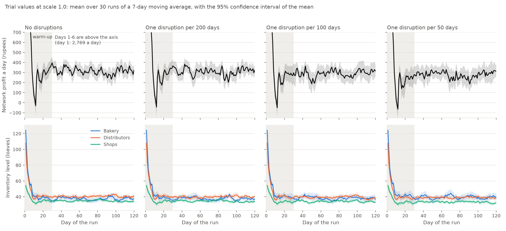

# Pilot runs

Before the search runs the [bread model](../model/README.md) tens of thousands of times, we need answers to three practical questions. How many of the first days of a run should be left out? How many days should a run measure, and how many seeds should each set of values be run on, so that two sets of values can be told apart? And how long does one run take?

The pilot answers them with a few hundred runs of hand-set values. From its answers we set the length of every run (a 30-day warm-up and 365 measured days) and the number of search seeds (10).

## What the pilot runs

The pilot uses the trial values of the model's checks, not values found by a search. They set each site's reorder point s and order-up-to level S as days of its own mean demand. At scale 1.0 these are 0.5 and 2.0 days at the bakery, 1.0 and 2.0 at the distributors, and 0.5 and 1.5 at the shops. The pilot multiplies them by 0.5, 1.0, 1.1 and 2.0, so that it sees small and large values, and two sets of values (1.0 and 1.1) close enough to be hard to tell apart.

Each set of values runs on seeds 9001 to 9030, which we use nowhere else, in each of our 4 cases (no disruptions of the bakery, and one disruption per 200, 100 or 50 days on average).

Money is in rupees and quantities are in loaves. A ± value is the half-width of a 95% confidence interval, the distance from the mean to either end of the interval.

## Warm-up

Every run starts with free initial inventory, nothing on its way and no order waiting, so its first days do not look like the rest of the run. Counting them would make a set of values that starts with many loaves look better than it is. We therefore leave out a warm-up in each run, reset its statistics, and only then start to measure.

To find how long the warm-up must be, we record each of the first 120 days of every run. For each period of the first 60 days, we compare the mean daily profit, seed by seed, with that of days 61 to 120, which are well past the start.



The figure shows the trial values at scale 1.0. The daily profit and the inventory level of each echelon fall over the first week or two and then vary around a steady level. In the comparison, days 1 to 7 differ from the late days in every case and at every scale. Some later periods still differ, up to days 22 to 30, most often at scale 2.0, which settles more slowly. From day 31 on, no case and no scale differs detectably from days 61 to 120.

We therefore leave out the first 30 days of every run.

## Run length and number of seeds

The mean profit of a set of values over a few seeds is only an estimate, and its confidence interval shows how precise it is. Too few seeds or too short runs give wide intervals, in which the search cannot tell good values from lucky ones. Too many cost time, since every candidate of the search runs on every seed.

After the 30-day warm-up, we measured each run at 182, 365 and 730 days, and found the half-width of the mean profit with 10 and with 30 seeds. We give profit a year, so that the run lengths compare.

| Case | 182 days, 10 seeds | 365 days, 10 seeds | 365 days, 30 seeds | 730 days, 10 seeds |
|---|---|---|---|---|
| No disruptions | 107,931 ± 8,459 | 110,765 ± 5,970 | 113,598 ± 3,269 | 109,594 ± 4,772 |
| One per 200 days | 110,191 ± 7,063 | 109,694 ± 4,955 | 109,584 ± 3,316 | 109,451 ± 5,124 |
| One per 100 days | 102,391 ± 8,044 | 103,848 ± 6,242 | 103,899 ± 4,483 | 103,897 ± 5,157 |
| One per 50 days | 93,232 ± 12,122 | 97,295 ± 8,031 | 98,598 ± 4,262 | 96,424 ± 6,527 |

The table gives the mean profit a year of the trial values at scale 1.0. With 365 days and 10 seeds, the half-width is 5% to 8% of the mean profit. Doubling the run length to 730 days narrows it by a fifth at most, at twice the cost, because profit drifts in slow swings that last months. Halving it to 182 days widens it by 30% to 50%.

The search compares sets of values with each other, and it runs every set on the same seeds (common random numbers), so the paired difference between two sets matters more than each mean. With 365 days and 10 seeds, scale 1.1 makes less than scale 1.0 by 26,739 ± 8,370 a year with no disruptions and by 27,453 ± 10,050 with one disruption per 50 days. So 10 seeds tell apart two sets of values that differ by 10% in every s and S, also in the case with the most disruptions.

We therefore measure 365 days in every run and run every candidate of the search on 10 seeds (1001 to 1010). The final checks of the [optimization](../optimization/README.md) use 100 further seeds, so that their intervals are narrower.

`results/replications.csv` holds every run, at every scale and run length, with its profit, customer fill rate and expired units.

## Run time

One run of 30 + 365 days takes about 0.5 seconds alone on the computer we used for the search, with or without disruptions. Runs are independent of each other, so the scripts run several at once, one per worker process.

| Runs at once | 1 | 2 | 4 | 8 | 16 |
|---|---|---|---|---|---|
| Seconds per run, in all | 0.57 | 0.28 | 0.14 | 0.092 | 0.090 |

That computer has 8 cores and 16 logical processors. 8 runs at once are 6 times as fast as 1, and the logical processors beyond the 8 cores add little. We use 8 worker processes for the search.

## Running the pilot

Run from the repository folder.

```
python -m pilot.run_pilot      # all pilot runs, writes the CSV files in pilot/results/ and prints a summary
python -m pilot.plot_warm_up   # draws pilot/results/warm_up.png from warm_up.csv, about 10 seconds
```

The pilot uses one worker process per logical processor. Apart from the run times, a new run gives exactly the same results. [FILES.md](../FILES.md) describes each file of this folder and the columns of each CSV file.
